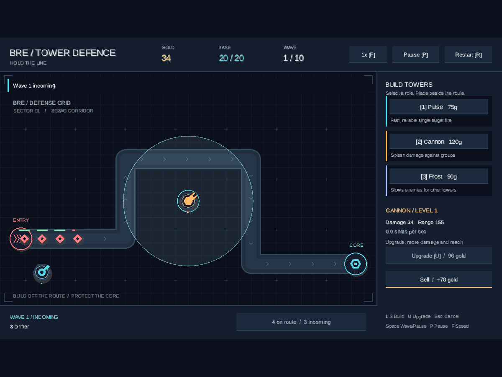

# BRE Tower Defence

A Kotlin/libGDX tower-defense game. Build a defence beside the route and protect the core through increasingly difficult waves.



## Run

Requires JDK 21 and an OpenGL-capable desktop. The first build downloads Gradle and dependencies.

```sh
./gradlew lwjgl3:run
```

On Windows use `gradlew.bat lwjgl3:run`. Build a runnable desktop JAR with `./gradlew lwjgl3:jar`; it is written to `lwjgl3/build/libs/`.

## Play

Use **Mission** to choose a route and difficulty. The mission screen previews the route, starting resources and enemy health. Place towers on free ground beside the route. Select a tower to see its stats, preview its next upgrade, change its target priority or sell it.

**Crosswind Pass** adds two diagonal ramps with space to build between the lanes. The **Sunder** tower strips shields quickly. **Vanguards** in the final waves carry shields and armor, so pairing Sunder with Rail covers both defenses.

**Twin Locks** adds two tight turns in the middle of the route. The **Tremor** tower (`0`) slows groups around an impact and unlocks at field rank 2. Finished missions award profile XP for cleared waves, plus a victory bonus. The profile saves locally and carries over between missions.

Choose **Remix** in mission setup to vary enemy order, spawn spacing and the position and size of the hills. Reroll for a new seed, or retry a mission to keep its seed and timings. **Copy code** shares the map, difficulty and seed. **Paste Remix code** loads those settings from the clipboard. The mission setup shows the local best for that code by waves cleared, then lives and kills. New Remix codes start with `BRE3`. The game also accepts older `BRE1` and `BRE2` codes under their original placement rules and stores their scores separately.

On **Twin Locks**, press **V** between waves to switch paths. Both routes remain reserved for enemies, and purple markers show the first recorded echo impact positions. At field rank 3, choose a **Tremor** module in mission setup. Wide covers a larger area with a weaker slow. Focused covers a smaller area with a stronger slow. The chosen module applies to the whole mission, including recorded echoes.

Start each wave when ready. The bottom bar previews the next wave, and the enemy guide explains when each enemy type appears and how to counter it. Survive 20 waves to win. The five new late waves include command patrols and a final mixed assault.

The Corridor's wave 15 features **Bastion**. Two gold-marked stretches drop its violet protection. If it reaches the core, the mission ends in defeat.

On The Corridor, the **Marshal** closes wave 20. Two relays arrive just ahead of it and maintain its protection outside the marked damage windows. Remove both relays to expose it for the rest of the wave. A breach loses the mission.

Winning The Corridor campaign unlocks **Relay Hunter** permanently in your local Rail workshop. Equip it in Mission Setup to double damage spent on shields and deal 25% more damage to the Marshal's relays. Rail takes 25% longer to reload with the module. Echoes and checkpoints keep the selected module.

Commanders in waves 17 and 19 cut damage to their two nearby escorts in half. A green link marks the protection. It breaks if the commander falls or moves too far away.

Open **Mission Setup → Workshop** to turn Classic campaign milestones into permanent research. Spend points on tower damage, reload, targeting range or starting gold. Higher difficulties also record mastery on easier ones. [Progression rules](docs/progression.md)

New missions show a 20-by-12 grid of build squares. The preview snaps to the square centre, with green for available squares and red for blocked or occupied squares. In build mode, corner marks show free squares and hatching marks unavailable ones. Click anywhere inside an occupied square to select that tower. Existing saves keep their original tower positions.

In Classic and new Remix missions, build on a terrace or summit to shoot farther downhill.
Base tower range is 6% shorter. Direct shots gain 10% per level downhill or lose 10% per level uphill.
Impact splash and chain jump distances stay fixed. Range previews mark reachable points along the active route, where + and − signs mark uphill and downhill transitions.
Classic maps have fixed hill layouts. Remix uses the seed for hill layout while keeping the map's routes.
Quick missions and missions resumed from older saves retain their original terrain and range.

Choose **Quick mission / 6 waves** in Mission Setup for a fixed 330-gold start and mixed squads on The Corridor. Quick missions have separate local bests for each difficulty.

Once a **Cannon** reaches level 3, you can specialize it once. Wide trades firing rate for splash radius. Rapid fires more often with a smaller blast. Echoes retain each shot's recorded radius.

Before wave 8, opt into **Elite [B]** to face three opening enemies with 60% more health. Yellow brackets mark Elites. Clearing that wave awards 90 extra gold.

The game keeps one local checkpoint between waves. Choose **Continue** at startup to restore your towers, wave state and pending echo. If you quit during combat, you resume from before that wave. Open **Wave report [L]** to see escapes and echo hits wave by wave.

Enemy health appears green and turns coral when critical. Cyan bars show remaining shield. Amber segments indicate persistent damage resistance, which Rail bypasses. A lilac plus shows active healing. The enemy guide includes the same symbols.

| Input | Action |
| --- | --- |
| Mouse | Choose/build/select towers and use HUD buttons |
| Shift + click | Place the selected tower and keep building while you can afford another in grid missions |
| Hover Upgrade | Preview the additional route coverage in gold |
| 1–9 / 0 | Choose a tower in catalogue order |
| M | Open mission setup |
| G | Read the enemy guide and pause the current wave |
| E | Arm or disarm the selected tower as the wave recorder |
| U | Upgrade selected tower |
| X | Overdrive the selected tower during a Classic wave, once per wave |
| Z / Undo | Refund the last untouched build placed during preparation, before the next wave starts |
| T | Cycle the selected tower’s target priority |
| Space | Start the next wave; pause/resume during combat |
| P | Pause/resume |
| F | Toggle 1x / 2x speed |
| F8 / SFX | Toggle combat sounds (saved in the local profile) |
| Right-click / Esc | Cancel placement or selection; Esc otherwise pauses |
| R | Request restart; confirm with Enter/R or cancel with Esc |

During a Classic wave, select a tower and activate **Overdrive [X]** to halve its reload times for five seconds. Each wave has one charge, so save it for a packed group or an exposed boss.

Before starting a wave, select a tower and use **Record [E]**. Its shots replay at the same times and positions in the next wave, even if you sell the tower. Enemies can move past a point before the echo fires. Purple rings mark upcoming impacts.

## Verify

Run the test closest to the change.

| Change | Command |
| --- | --- |
| Wave echo | `./gradlew --quiet --console=plain :core:test --tests '*WaveEchoTest'` |
| Campaign balance | `./gradlew --quiet --console=plain :core:test --tests '*BalanceSimulationTest'` |
| HUD, input or rendering | `./gradlew --quiet --console=plain :lwjgl3:smokeTest` |
| Full build and tests | `./gradlew --quiet --console=plain build` |

The desktop smoke test needs a display. On headless Linux, prefix the command with `xvfb-run -a`. The screenshot is written to `lwjgl3/build/reports/desktop-smoke.png`. PR CI runs the full build and the desktop smoke test, and uploads available diagnostics on failure.

## Structure

- `core/.../simulation`: plain Kotlin rules, movement, combat, waves and economy; no graphics dependencies in these classes.
- `core/.../ui`: input, HUD, viewport, pause and mission screens.
- `core/.../rendering`: procedural battlefield, unit silhouettes and tick-driven combat effects.
- `lwjgl3`: desktop launcher, packaging and rendered smoke check.
- `assets`: original template graphics retained; procedural battlefield art and a bundled, openly licensed DejaVu Sans Latin font (license in `assets/fonts/LICENSE.txt`). No runtime asset downloads.

See [AGENTS.md](AGENTS.md) for entry points, [game-design.md](docs/game-design.md) for design decisions, [balance.md](docs/balance.md) for campaign probes, and [verification.md](docs/verification.md) for first-mission verification.
